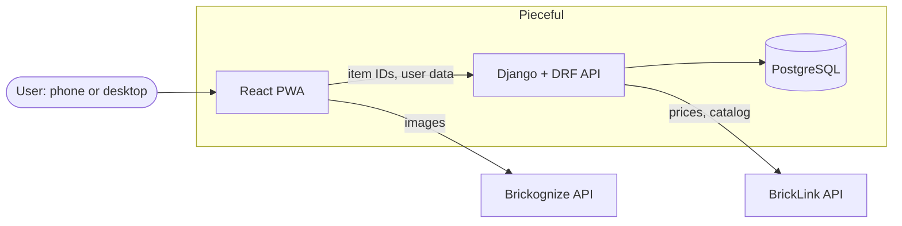
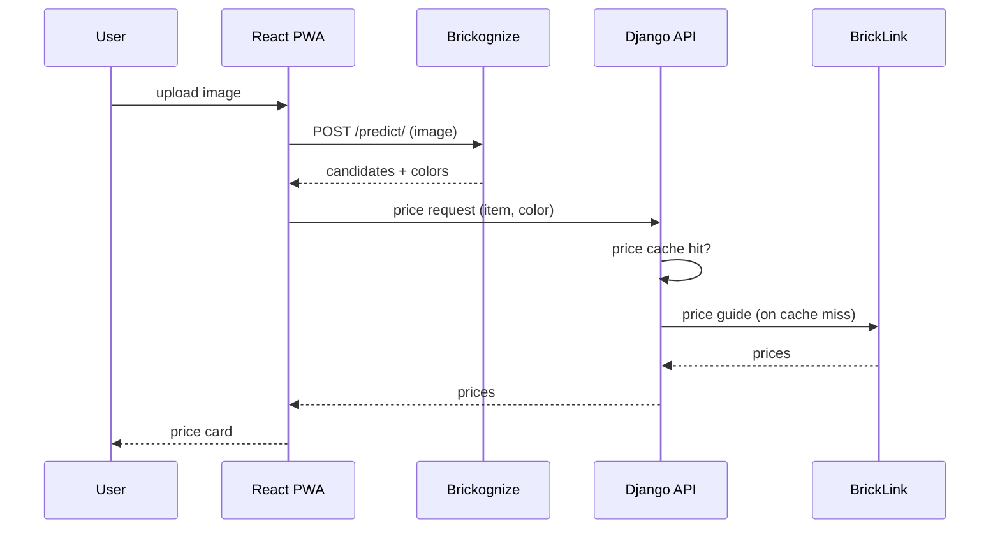

# Architecture

**Status:** Draft

## Goals and constraints
- Mobile-first PWA that also works on desktop with a webcam.
- **No user images on the server:** the browser calls Brickognize directly. Brickognize allows cross-origin requests. See [ADR 0003](decisions/0003-browser-side-recognition.md).
- **BrickLink is backend-only:** its API sends no CORS headers and uses OAuth 1.0a with IP-bound tokens, so credentials must stay server-side.
- **Low third-party load:** cache, deduplicate, and throttle every external call.
- **Stack:** see [ADR 0002](decisions/0002-baseline-stack.md).

## Context

## Scan flow (first increment)

## Cross-cutting constraints
These apply from the first increment, so later features do not require rework.
- **User-owned data model:** every user-data table has an owner from the start, even before accounts exist. Adding authentication must not require a data migration.
- **Client-generated IDs:** the client creates UUIDs for scans and inventory entries, and write endpoints are idempotent. This keeps offline scanning possible later.
- **Request deduplication:** identical in-flight requests (same item, color, and parameters) are merged, both in the client and on the server.
- **Throttling and backoff:** the client throttles calls to Brickognize and the API, and backs off on errors and `429` responses.
- **Catalog images:** the service worker caches Brickognize catalog images cache-first for about 30 days and revalidates with `ETag`. The server stores no images.
- **Recognize once:** a crop is sent to Brickognize once. Swapping to another candidate reuses the stored candidate list.
- **Price cache:** BrickLink price-guide results are cached server-side in a PostgreSQL table with TTL columns, shared across users. No separate cache service for the MVP.

## BrickLink usage budget
| Item | Value |
|---|---|
| Daily API call limit | 5,000 calls per day (**to verify**) |
| Calls per uncached item + color | Up to 4 (new / used × sold / for sale) |
| Uncached items per day | About 1,250 at the limit above |
| Tokens | IP-bound: development, CI, and production each need their own registration |
| Quota exhausted | Serve cached (stale) prices with a notice; never retry in a loop |

Only the top-ranked candidate is priced right away. Other candidates are priced when the user swaps to them.

## Risks and assumptions
| # | Assumption | Impact if wrong | Verification | Gate |
|---|---|---|---|---|
| R-01 | Brickognize item and color IDs map directly to BrickLink item type, number, and color ID | Price lookups fail or return the wrong item | Spike: about 30 real responses (parts, minifigures, sets, stickers, printed and multi-color parts) checked against BrickLink `GET /items/{type}/{no}` and the price guide; record the behaviour when no color is predicted | Before M1 |
| R-02 | BrickLink API terms allow showing price-guide data in a third-party app | The product premise changes; another price source is needed | API terms review | Before M1 |
| R-03 | The BrickLink daily limit and account type match the budget above | The cache TTL and the per-user limits must change | API terms review | Before M1 |
| R-04 | Brickognize allows production use from a third-party browser client, and its public endpoints stay available (the OpenAPI spec marks `/predict/` and `/feedback/` as deprecated, with no replacement listed) | Recognition must be proxied, migrated, or replaced | Terms review and confirmation from Brickognize, including the deprecation status | Before closed alpha 1 |

## To be specified
Modules (Django apps), data model, API conventions, auth, deployment.
