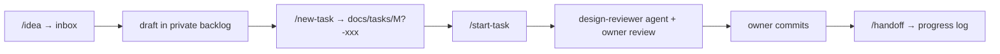

# AI-assisted workflow

**Status:** Draft

This project is developed with [Claude Code](https://claude.com/claude-code). This guide explains how the pieces fit together.

> **If you only remember one thing: type `/next`.** It checks where things stand and proposes the next step.

## Cheat sheet
| You want to… | Type |
|---|---|
| Continue where you left off / not sure what to do | `/next` |
| Write down an idea without discussing it | `/idea <text>` |
| Turn an idea or feature into a buildable task | `/new-task` |
| Build a task | `/start-task M1-001` |
| Record a design decision | `/adr` |
| Check docs and code still agree | `/sync-docs` |
| Get a senior tech lead's critical review of the design | `/tech-review [scope]` |
| Wrap up a session | `/handoff` |

## The lifecycle

1. **Capture:** ideas go into a private inbox right away, with no discussion needed.
2. **Refine:** an idea becomes a draft, then a public task spec with scope, acceptance criteria, and a test plan. Claude asks about anything unclear.
3. **Build:** Claude reads the spec and linked docs, implements, tests, and runs the reviewer agent. Then it **stops** for review.
4. **Review & commit:** the owner reviews the diff. Claude commits only when asked.
5. **Handoff:** the progress log records what was done and what's next. The next session starts from there.

## Where context lives
| Layer | Location | Contents |
|---|---|---|
| Public | `AGENTS.md`, `docs/` | Settled requirements, specs, architecture, ADRs, tasks |
| Private | separate notes repo, loaded through the gitignored `CLAUDE.local.md` | Raw ideas, drafts, research, session log |

## Building blocks
- **Skills** (`.claude/skills/`): the slash commands above. Each is a short instruction file.
- **Agents** (`.claude/agents/`): read-only reviewers that start with a fresh context, so they judge the work as written.
  - `design-reviewer` checks a **code change** against the task spec, ADRs, conventions, and the [Definition of Done](definition-of-done.md). `/start-task` runs it.
  - `tech-lead` is a senior tech lead who critically reviews **design docs and plans**: gaps, contradictions, risky assumptions, MVP path. `/tech-review` runs it, ideally at every phase checkpoint before approval.
- **Hooks** (`.claude/settings.json`):
  - **SessionStart** (active): prints the current state from the progress log when a session starts.
  - **Quality gates** (planned for M0): run format/lint after edits and tests before Claude finishes.

## Good habits
- Start a **new session per task**. It keeps the context focused, and the progress log carries state over.
- Review the diff, not just the summary.
- If Claude starts deciding design questions on its own, point it to the working rules in `AGENTS.md`.
